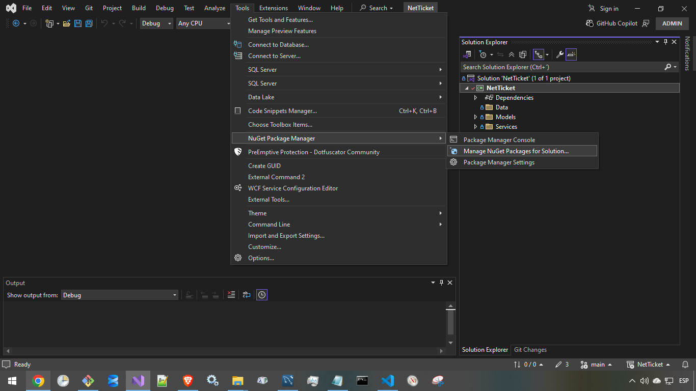
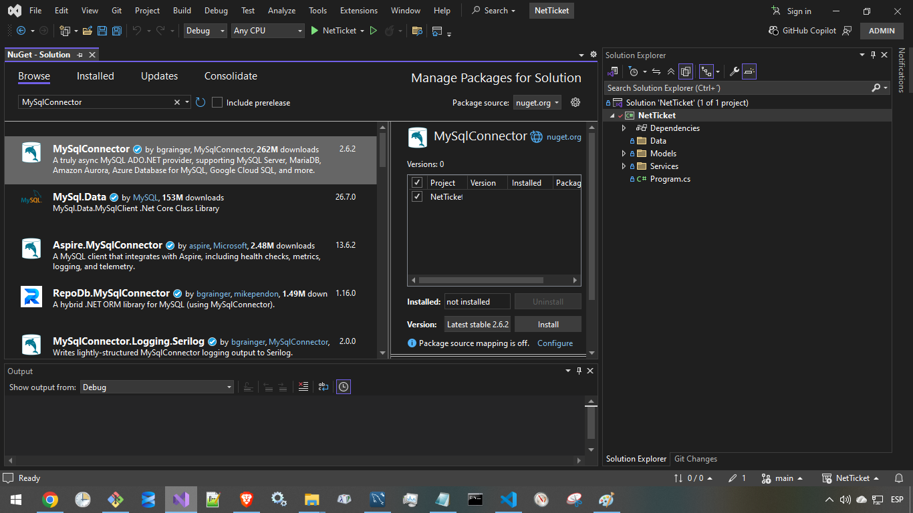

MySqlConnector es un controlador ADO.NET en C# para MySQL Server , MariaDB , Amazon Aurora , Azure Database for MySQL , Google Cloud SQL for MySQL , Percona Server y más. Proporciona implementaciones de DbConnectionlas DbCommandclases necesarias para consultar y actualizar bases de datos desde código C#.DbDataReaderDbTransaction

https://mysqlconnector.net/

Instale MySqlConnector desde NuGet :dotnet add package MySqlConnector

